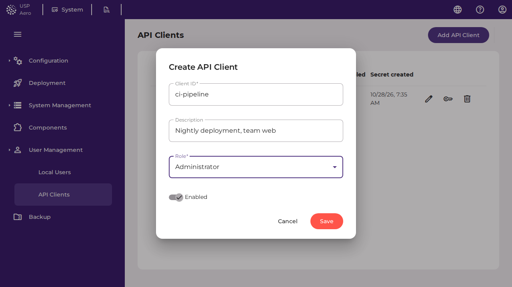
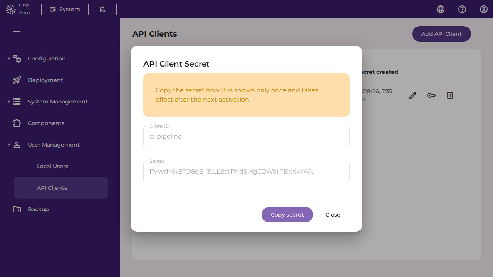

# Access the management API

Scripts, CI pipelines and other machines can call the same API that the management GUI uses,
without a person signing in. Such a caller is an **API client**: it has a client ID, a secret and a
role. With the ID and secret it requests a short-lived token from the appliance (OAuth 2.0 client
credentials grant) and sends that token with every API call.

## Create an API client

1. Open [User Management → API Clients](../../reference/gui/user-management/api-clients) and click
   "Add API Client".
2. Enter a [Client ID](../../reference/gui/user-management/api-clients#id), for example
   `ci-pipeline`, and a description that says who owns the client.
3. Select the [Role](../../reference/gui/user-management/api-clients#role). Choose `Viewer` if the
   client only reads, `Administrator` only if it has to change or deploy configuration.

   

4. Save. The secret is shown **once**: click "Copy secret" and store it in the secret store of the
   script or pipeline before you close the dialog.

   

5. [Create a revision and deploy it](../../concepts/configuration-lifecycle). The client can get
   tokens only after the deployment.

## Get a token

Request a token from the appliance's token endpoint `https://<appliance>/dex/token`. Authenticate
with the client ID and secret (HTTP Basic authentication) and request the scopes
`openid profile groups`:

```bash
AERO=https://aero.example.com
TOKEN=$(curl -s -u "ci-pipeline:$AERO_CLIENT_SECRET" \
  -d grant_type=client_credentials \
  --data-urlencode 'scope=openid profile groups' \
  "$AERO/dex/token" | jq -r .access_token)
```

The response contains the token and its lifetime in seconds:

```json
{ "access_token": "eyJhbGciOiJSUzI1NiIs…", "token_type": "bearer", "expires_in": 299, "id_token": "eyJ…" }
```

All three scopes are required:

- `groups` puts the client's role into the token. A token without it is rejected with `403`.
- `profile` puts the client ID into the token, so that the logs show the caller by its ID.

A token is valid for 5 minutes and can't be refreshed. Request a new one when it has expired, or
whenever an API call returns `401`. Reusing a token until shortly before `expires_in` is fine.

## Call the API

Send the token in the `Authorization` header:

```bash
# Read: list the components and their configuration revisions (Administrator or Viewer)
curl -s -H "Authorization: Bearer $TOKEN" "$AERO/api/clm/components"

# Deploy the newest revision of the WAAP component; the deployment runs in the background (Administrator only)
curl -s -H "Authorization: Bearer $TOKEN" -H 'Content-Type: application/json' \
  -X POST "$AERO/api/clm/components/activation" -d '["waap"]'
```

There is no published API reference yet. Every action in the management GUI is an API call, so the
network view of the browser's developer tools shows the requests to rebuild for a task.

An API client can do what a user with the same role can do, with a few exceptions, see
[Roles and permissions](../../concepts/roles-and-permissions#api-clients). Every change it makes is
logged with its ID, for example `ci-pipeline (API client) POST /api/clm/components/activation -> 200`.

## HA clusters

In an [HA cluster](../ha/set-up-an-ha-cluster) every node issues its own tokens, and a token is only
accepted by the node that issued it. Therefore:

- Send the token request and the API calls to the **same address**, preferably the cluster's address (its
  virtual IP address, or a hostname that resolves to it), and not to the address of an individual node.
- After a failover, the first API call with the old token returns `401`. Request a new token with the
  same client ID and secret and repeat the call. All nodes know the same API clients with the same
  secrets.

## Change the secret

The [API Clients](../../reference/gui/user-management/api-clients#secretRotatedAt-column) list warns
when a secret is older than recommended. To replace it:

1. Agree on a time with the owner of the script or pipeline: between the deployment (step 3) and the
   update of the secret store (step 4), the client can't get new tokens.
2. Click [Regenerate secret](../../reference/gui/user-management/api-clients#regenerate-secret) and
   copy the new secret.
3. Create a revision and deploy it. From then on, the old secret is rejected.
4. Store the new secret in the secret store of the script or pipeline.

For a change without any interruption, create a second client with the same role, switch the script
or pipeline to it, then delete the old client.

## Troubleshooting

| Response | Cause |
|---|---|
| `401` with `invalid_client` from `/dex/token` | Wrong client ID or secret, the client is disabled or deleted, or the change has not been deployed yet. |
| `302` redirect to the login page | The request has no `Authorization` header. |
| `401` from an API call | The token has expired or is invalid, or, in an HA cluster, it was issued by another node. Request a new token. |
| `403` with `RBAC: access denied` | The token has no role: request it with the scope `openid profile groups`. |
| `403` from an API call | The client's role doesn't allow the action (for example a `Viewer` changing configuration), or the action is reserved for people (see [Roles and permissions](../../concepts/roles-and-permissions#api-clients)). |
