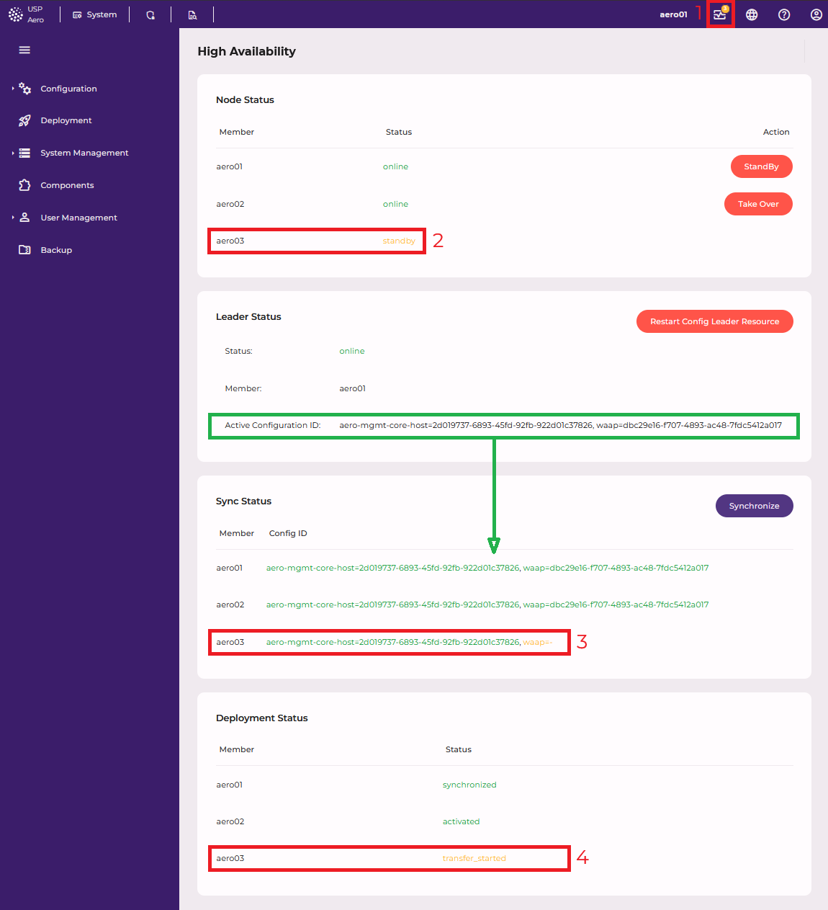
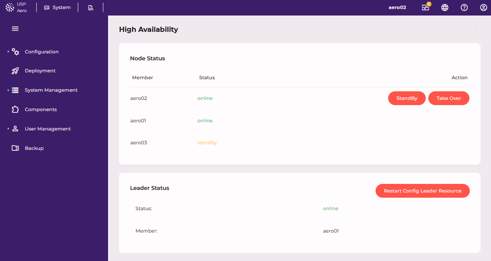
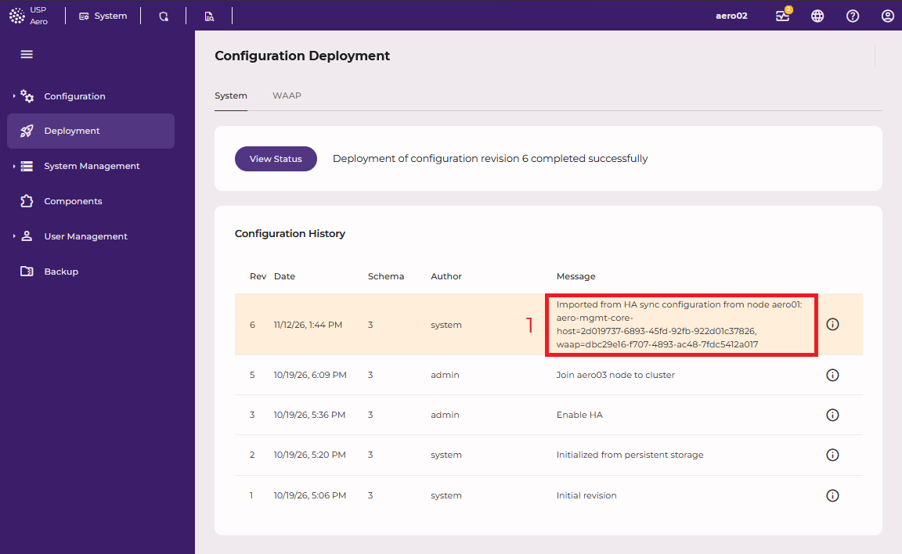

# High Availability status

> [!NOTICE]
> This feature is planned to be available from version 1.1 onwards.

This screen shows the operational status of an HA cluster set up on the
[High Availability](../configuration/high-availability) configuration screen. It is only available on
an HA-capable deployment.

The *High Availability* page (*System Management > High Availability*) shows the current state of your HA cluster:
which nodes are online, which node is the leader, which configuration each node runs, and how far the last
synchronization got. It also offers the actions you need to operate the cluster.

The page updates by itself whenever the cluster state changes. You do not need to reload it.

{#leader-view}

The example above shows the page on the leader `aero01` while node `aero03` is in standby:

1. The HA indicator in the top bar shows a yellow badge, because some areas need attention.
2. In *Node Status*, `aero03` is `standby` (yellow).
3. In *Sync Status*, `aero03` has not received the `waap` component yet (`waap=-`, yellow). Every *Config ID* that matches the *Active Configuration ID* is considered synchronized (green).
4. In *Deployment Status*, the last synchronization has not completed on `aero03` because it is in `standby` (`transfer_started`, yellow).

> [!TIP]
> Open this page on the **leader node**. The *Active Configuration ID* and the *Sync Status* and
> *Deployment Status* sections are only shown there, because only the leader knows which configuration the
> cluster should be running. On a follower, the page shows only *Node Status* and *Leader Status*.

In read-only mode, the page shows no action buttons.

## Colours at a glance

The page and the HA indicator in the top bar use the same three colors:

| Color      | Meaning                                                                                      |
|------------|----------------------------------------------------------------------------------------------|
| **Green**  | Everything is OK.                                                                            |
| **Yellow** | HA works, but something needs your attention, for example a node is in standby or not synchronized yet. |
| **Red**    | HA is limited or unavailable, for example a node is offline or a synchronization failed.     |

### The HA indicator in the top bar

The indicator is shown once the HA cluster has members. The heart-shaped icon in the top bar summarizes the whole page. It evaluates four areas, one for each section of
this page: nodes, leader, synchronization and deployment.

- **No badge:** all four areas are green.
- **Badge with a number:** the number of areas that are not green. The badge is **red** if at least one area is red,
  otherwise it is **yellow**.

Click the icon to open this page and see which area needs attention.

## Node Status

Lists every node configured in the cluster, with its current state and the actions you can take on it.

| Column     | Meaning                                        |
|------------|------------------------------------------------|
| **Member** | The node's hostname.                           |
| **Status** | The node's state as reported by the cluster.   |
| **Action** | Buttons to change the node's role (see below). |

### Node states

| Status        | Color  | Meaning                                                                                        |
|---------------|--------|------------------------------------------------------------------------------------------------|
| `online`      | Green  | The node is running and takes part in the cluster.                                             |
| `standby`     | Yellow | You put the node into standby. It runs no cluster services and does not take over on failure.  |
| `maintenance` | Yellow | The node is in maintenance mode. The cluster does not manage its services.                     |
| `pending`     | Yellow | The node is joining or leaving the cluster.                                                    |
| `offline`     | Red    | The cluster cannot reach the node. If another node fails, this one cannot take over.           |
| `unclean`     | Red    | The node is in an undefined state, for example after a crash, until the cluster has recovered it. |
| `unknown`     | Yellow | The cluster state could not be read.                                                          |

In the top bar indicator, this area is **red** if any node is `offline` or `unclean`, **yellow** if any other node is
not `online`, and **green** if all nodes are `online`.

### Actions

- **StandBy** / **UnStandby**: shown only on the row of the node you are signed in to. *StandBy* takes the node out
  of service: it stops running cluster services, and if it is the leader, another node becomes the leader.
  *UnStandby* brings it back.
- **Take Over**: shown on every online node that is not the leader. It makes that node the new leader.

Each action asks for confirmation first.

## Leader Status

Shows which node is currently the leader. The leader is the node where you change the configuration and start
synchronizations.

| Row                         | Meaning                                                                                              |
|-----------------------------|------------------------------------------------------------------------------------------------------|
| **Status**                  | `online` (green): a leader is active. `offline` (red): no node is acting as leader at the moment.    |
| **Member**                  | The hostname of the current leader, or `-` if there is none.                                         |
| **Active Configuration ID** | Only shown on the leader. The configuration revision that is **currently active on the leader**, per component, for example `aero-mgmt-core-host=12, feature-waap=7`. `-` if none is known yet. |

A leader that is `offline` usually means the cluster is switching over (for example right after *Take Over*), or
every node is in standby. If it stays `offline`, use **Restart Config Leader Resource** (next to the section
title). Leadership may briefly move to another node while it restarts.

## Sync Status

Only shown on the leader. Shows which configuration each node has received through HA synchronization.

| Column        | Meaning                                                                                                   |
|---------------|-----------------------------------------------------------------------------------------------------------|
| **Member**    | The node's hostname.                                                                                      |
| **Config ID** | Per component, the configuration revision the node last synchronized, for example `feature-waap=7`. `-` if the node has never been synchronized. |

The **Trigger Sync** button next to the section title starts a synchronization to all followers. If the followers
already have the leader's active configuration, it first asks you to confirm, because a forced synchronization
creates and activates a new revision on every follower.

### Active Configuration ID vs. Config ID

The two values look similar, but they answer different questions:

|                    | *Active Configuration ID* (Leader Status)                | *Config ID* (Sync Status)                                       |
|--------------------|----------------------------------------------------------|-----------------------------------------------------------------|
| Question           | What does the leader run **right now**?                  | What did each node **last synchronize**?                        |
| Shown for          | The leader only                                          | Every node, including the leader                                |
| Changes when       | You activate a new revision on the leader                | A synchronization runs                                          |
| Leader's own value | Its currently active revisions                           | The revisions it last **sent** to the followers                 |
| Follower's value   | –                                                        | The revisions it last **received and activated**                |

The *Active Configuration ID* is the reference. When you activate a new configuration on the leader, only the
*Active Configuration ID* changes. Every *Config ID*, including the leader's own row, still shows the previous
revision until you start a synchronization. When the synchronization is complete, every node's *Config ID* matches
the *Active Configuration ID* again.

### Colors

Every *Config ID* entry is compared with the *Active Configuration ID* of the same component:

| Entry                                                    | Color  | Meaning                                                      |
|----------------------------------------------------------|--------|--------------------------------------------------------------|
| Same revision as the active configuration                | Green  | This component is up to date on this node.                   |
| Component not part of the active configuration           | Green  | There is nothing to compare against.                         |
| Different revision                                       | Red    | The node runs a different configuration. Synchronize.        |
| `component=-` (added automatically)                      | Yellow | The node has not received this component yet, for example after you installed a new feature. Synchronize. |

In the top bar indicator, this area is **red** if any node runs a different revision of a component, **yellow** if a
node has not received a component at all or the *Active Configuration ID* is not known yet, and **green** if every
node matches. On a follower, this area is not evaluated and is always green, so a follower's indicator does
**not** tell you whether the nodes are up to date. To check that, open this page on the leader.

## Deployment Status

Only shown on the leader. Shows the progress and outcome of the last synchronization on each node.

| Column     | Meaning                                                                         |
|------------|---------------------------------------------------------------------------------|
| **Member** | The node's hostname.                                                            |
| **Status** | The last synchronization step the node reported, or *Unknown* if none so far.   |

### Status values

Values reported by the **leader** node:

| Status           | Meaning                                                                    |
|------------------|----------------------------------------------------------------------------|
| `export_started` | The leader is exporting its active configuration.                          |
| `exported`       | The export is done. The followers have been told to copy it.               |
| `synchronized`   | A follower has successfully activated the leader's configuration.          |
| `sync_failed`    | The export failed.                                                         |

Values reported by a **follower** node, in the order they occur:

| Status                     | Meaning                                                                  |
|----------------------------|--------------------------------------------------------------------------|
| `transfer_started`         | The leader asked this node to copy its configuration.                    |
| `transferred`              | The configuration has been copied to this node.                          |
| `component_deploy_started` | Components are being installed, updated or removed to match the leader.  |
| `components_ready`         | All components match the leader.                                         |
| `import_started`           | The configuration is being stored as new revisions.                      |
| `imported`                 | The new revisions have been created.                                     |
| `activation_started`       | The new revisions are being activated.                                   |
| `activated`                | Done: the node runs the leader's configuration.                          |
| `sync_failed`              | The synchronization failed on this node. It keeps its previous configuration. |

Each status is colored: `sync_failed` is **red**, `activated` and `synchronized` are **green**, and every other
value, including *Unknown*, is **yellow** (still in progress). The top bar indicator uses the same rule: this area is
**red** if any node reports `sync_failed`, **green** if every node reports `activated` or `synchronized`, and
**yellow** otherwise.

When a follower reports `activated`, the synchronized configuration appears as a new revision on that follower's
*Deployment* page. Its author is `system`, and its message names the leader it was imported from and the
synchronized configuration IDs:

1. The *Config ID* synchronized by the leader. See *Active Configuration ID* in *Leader Status* on the *[leader view](#leader-view)*.

## Typical situations

| What you see                                                                 | What it means / what to do                                       |
|------------------------------------------------------------------------------|------------------------------------------------------------------|
| All green, no badge in the top bar                                           | The cluster is healthy and every node runs the leader's configuration. |
| Red *Config ID* entries after you activated a change on the leader            | Expected: the nodes still run the previous revision. Start a synchronization with **Trigger Sync**. |
| Yellow `component=-` entries after you installed a new feature                | Expected. Start a synchronization with **Trigger Sync**.         |
| A node `standby` (yellow)                                                    | The node does not take over on failure. Use **UnStandby** on that node, then synchronize it. |
| A node `offline` (red)                                                       | Check the node and its network connection. Until it is back, the cluster has less or no failover protection. |
| Leader `offline` (red) for more than a few moments                           | Use **Restart Config Leader Resource**, or **Take Over** on a healthy node. |
| A follower stays at `sync_failed`                                            | Check the follower's logs for the cause, fix it, and synchronize again. |
